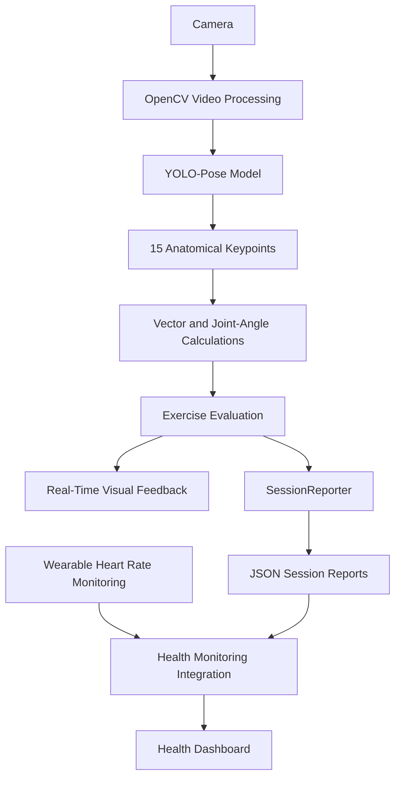

# ORION — Intelligent Biomechanical Analysis and Astronaut Health Monitoring

**NASA International Space Apps Challenge 2026 — Project HEALTH**

ORION is an intelligent biomechanical analysis and health monitoring system developed for the NASA International Space Apps Challenge 2026. The project combines computer vision, machine learning, mathematical modeling, and wearable technology to support physical exercise monitoring during long-duration space missions.

The system was designed to address a significant challenge in human space exploration: maintaining astronauts' physical condition in microgravity, where the absence of normal gravitational loading contributes to muscle atrophy, bone density loss, and cardiovascular deconditioning.

ORION uses artificial intelligence to identify human body movements, calculate joint angles, and evaluate exercise execution in real time. By detecting postural deviations and providing immediate visual feedback, the system aims to help astronauts perform exercises more consistently and recognize potentially unsafe movement patterns.

The broader HEALTH project also includes a wearable heart rate monitoring component and a data visualization dashboard intended to consolidate physiological and biomechanical information.

The objective is to investigate how these technologies can support astronaut autonomy, exercise monitoring, and physical well-being in environments where continuous supervision by medical or rehabilitation professionals may not be available.

---

# 1. Project Overview

Long-duration space missions introduce physiological challenges that differ considerably from those experienced on Earth.

Under terrestrial conditions, gravity continuously imposes mechanical loads on the musculoskeletal system. These loads contribute to maintaining muscle strength, bone structure, and normal movement patterns.

In microgravity, this mechanical stimulus is significantly reduced. Over time, astronauts may experience decreased muscle mass, changes in muscle function, reduced bone mineral density, and alterations in cardiovascular regulation.

To reduce these effects, astronauts aboard the International Space Station follow structured exercise programs that include resistance and aerobic training.

One example is the Advanced Resistive Exercise Device (ARED), which allows astronauts to perform resistance exercises despite the absence of conventional gravitational loading.

However, performing an exercise does not necessarily guarantee that it is being executed with appropriate movement mechanics.

Joint alignment, movement amplitude, body orientation, and the coordination between different body segments can influence exercise performance.

Incorrect execution may introduce undesirable mechanical loading or reduce the effectiveness of the intended movement.

ORION was developed to investigate whether artificial intelligence could provide an additional monitoring layer during these exercise sessions.

Rather than relying exclusively on visual observation by another person, the system uses a camera to analyze movements automatically.

The software identifies anatomical reference points, reconstructs a simplified representation of the human skeleton, and calculates joint angles using vector mathematics.

These measurements are compared with predefined biomechanical criteria to determine whether the observed movement is consistent with the expected exercise pattern.

When a deviation is detected, the system provides visual feedback that allows the user to recognize the issue and adjust their movement.

This approach is intended to support exercise monitoring rather than replace medical evaluation or professional supervision.

---

# 2. System Operation

The ORION software is built around a real-time computer vision pipeline.

Its primary input is a video stream captured through a webcam or another compatible camera.

Each video frame is processed by a pose estimation model based on Ultralytics YOLO-Pose.

The model identifies the person in the image and estimates the positions of anatomical keypoints.

Unlike conventional image classification systems, which primarily determine what objects appear in an image, pose estimation models provide spatial information about the human body.

ORION uses this information to evaluate movement geometry.

The processing pipeline consists of image acquisition, pose estimation, anatomical point extraction, mathematical analysis, exercise evaluation, and visual feedback.

## 2.1 Video Acquisition and Processing

OpenCV is responsible for capturing and processing video frames.

During an exercise session, the camera continuously provides images that are passed to the pose estimation model.

The software analyzes each frame to determine the position of the user and the anatomical landmarks required for biomechanical calculations.

The system must account for variations in lighting, camera distance, body orientation, and partial occlusion.

These conditions are particularly important because the accuracy of joint-angle calculations depends on the quality of the estimated anatomical positions.

## 2.2 Human Pose Estimation

ORION uses a custom pose estimation model configured to identify 15 anatomical keypoints.

The project adopts the following convention:

| Index | Anatomical Keypoint |
|-------|---------------------|
| 0 | Head |
| 1 | Left shoulder |
| 2 | Right shoulder |
| 3 | Left elbow |
| 4 | Right elbow |
| 5 | Left wrist |
| 6 | Right wrist |
| 7 | Left hip |
| 8 | Right hip |
| 9 | Left knee |
| 10 | Right knee |
| 11 | Left ankle |
| 12 | Right ankle |
| 13 | Left hand |
| 14 | Right hand |

The same anatomical convention was maintained throughout all three model training stages.

This consistency is important because changing the meaning or order of keypoints between datasets would introduce errors into the learning process.

The original YOLOv8 pose model uses 17 COCO keypoints. Therefore, a conversion procedure was required to adapt the pretrained model to ORION's custom 15-point representation.

The left and right anatomical conventions were also standardized to avoid inconsistencies between datasets.

During the multi-angle calibration stage, the hand keypoints were refined using corresponding MediaPipe landmarks.

Once the keypoints are detected, the software connects relevant anatomical points to represent body segments.

This representation allows the system to evaluate relationships between joints during movement.

---

# 3. Mathematical Biomechanical Analysis

One of ORION's main technical components is its ability to transform anatomical coordinates into quantitative movement measurements.

Pose estimation provides the coordinates of anatomical keypoints, but these coordinates alone do not indicate whether an exercise is being performed correctly.

To evaluate movement, the system applies vector mathematics and trigonometric calculations.

## 3.1 Joint-Angle Calculation

A joint angle can be estimated using three anatomical points.

For example, knee flexion can be calculated using the hip, knee, and ankle coordinates.

Let:

- A represent the hip.
- B represent the knee.
- C represent the ankle.

Two vectors are constructed using the knee as their common origin:

$$
\vec{u} = A - B
$$

$$
\vec{v} = C - B
$$

The angle between these vectors is calculated using the dot product:

$$
\theta =
\cos^{-1}
\left(
\frac{\vec{u}\cdot\vec{v}}
{\|\vec{u}\|\|\vec{v}\|}
\right)
$$

Where:

- \(\theta\) represents the estimated joint angle.
- \(\vec{u}\) and \(\vec{v}\) represent the body-segment vectors.
- \(\vec{u}\cdot\vec{v}\) represents their dot product.
- \(\|\vec{u}\|\) and \(\|\vec{v}\|\) represent their magnitudes.

The resulting angle can be converted from radians to degrees.

This method allows the software to estimate joint flexion and extension from the detected anatomical coordinates.

The calculations are based on the two-dimensional projection of the body in the camera image.

Consequently, the estimated angles may differ from actual three-dimensional joint angles when body segments are rotated relative to the camera.

For this reason, camera positioning and body orientation are important considerations in the system.

## 3.2 Exercise Evaluation

After calculating the required angles, ORION compares the measurements with predefined exercise criteria.

During a squat, for example, the software can examine knee flexion, hip movement, and trunk inclination.

The project documentation includes example monitoring thresholds of approximately 15 degrees for leg asymmetry and 45 degrees for trunk inclination.

These values are used as configured criteria within the prototype and should not be interpreted as universally validated clinical limits.

When a measurement exceeds the corresponding criterion, the system can generate a visual warning.

This allows the user to identify a possible movement deviation while the exercise is being performed.

## 3.3 Measurement Stability

An important challenge in camera-based biomechanical analysis is that small errors in anatomical keypoint positions can influence calculated joint angles.

The project uses several techniques intended to reduce this problem.

Higher-resolution images preserve more information about body segments, particularly when the user is positioned farther from the camera.

Consistent anatomical labeling reduces systematic errors caused by incorrectly assigned body sides.

MediaPipe-based landmark refinement can help stabilize keypoint positions during dataset preparation.

The system also considers filtering geometrically unreliable frames, particularly when body segments overlap in the two-dimensional image.

Temporal stabilization is used to evaluate movement patterns across multiple frames instead of relying exclusively on isolated measurements.

These techniques are intended to improve the consistency of movement analysis.

However, their effectiveness must be evaluated experimentally under different camera and exercise conditions.

---

# 4. Artificial Intelligence Model Development

The development of ORION required adapting a human pose estimation model to different visual environments.

A model trained exclusively on terrestrial exercise images may have difficulty interpreting astronaut movements in microgravity.

The appearance of the human body, the direction of movement, and the relationship between the camera and the subject can differ substantially between these environments.

To address this challenge, ORION adopted a three-stage incremental learning process.

Each stage begins with weights obtained from the previous training stage.

This strategy allows the model to progressively incorporate new data without restarting the learning process from randomly initialized parameters.

The training sequence was:

**Ground Training → Space Adaptation → Multi-Angle Calibration**

The final model was developed through this cumulative process.

## 4.1 Stage One — Ground Training

The first training stage established the model's initial understanding of human anatomy and exercise movements.

Training began with the pretrained `yolov8n-pose.pt` model.

This model was originally trained using the COCO dataset and configured to identify 17 human anatomical keypoints.

Because ORION uses a custom 15-keypoint representation, the original annotations were converted using a mapping procedure.

The dataset consisted of 183 training images and five validation images.

The images represented squat exercises performed under controlled terrestrial conditions.

Training was configured with the following parameters:

| Parameter | Configuration |
|-----------|---------------|
| Initial model | yolov8n-pose.pt |
| Training images | 183 |
| Validation images | 5 |
| Epochs | 40 |
| Image resolution | 640 pixels |
| Batch size | 16 |
| Cosine learning rate | Enabled |
| Close mosaic | 10 |
| Random seed | 42 |

The purpose of this stage was to establish a foundation for detecting the human body and estimating anatomical landmarks.

During training, the model progressively reduced its prediction errors.

The training bounding-box loss decreased from 2.0069 to 1.1043.

The classification loss decreased from 1.7195 to 0.8265.

The pose estimation loss decreased from 9.2416 to 2.7832.

The model achieved a bounding-box mAP50 of 0.995.

These results indicated that the model learned to localize people effectively within the controlled terrestrial dataset.

The resulting weights were then used as the starting point for the space adaptation stage.

## 4.2 Stage Two — Space Adaptation

The second stage introduced images representing astronaut exercise conditions aboard the International Space Station.

The main challenge was the difference between terrestrial exercise imagery and astronaut movements in microgravity.

In space, astronauts may appear in unusual orientations, and their movements can occur without the gravitational references normally present on Earth.

The available space dataset contained 86 frames extracted from astronaut exercise videos.

Because these frames did not initially include manually annotated anatomical keypoints, the project adopted a pseudo-labeling strategy.

A generic pretrained YOLO-Pose model was used as a teacher to generate pose annotations.

The teacher model's 17 keypoints were then converted into ORION's custom 15-keypoint representation.

Frames where the teacher model could not identify a suitable pose were excluded from the pseudo-labeling process.

The training dataset combined the original terrestrial images with the additional space-related frames.

Training continued from the weights obtained during the first stage.

| Parameter | Configuration |
|-----------|---------------|
| Initial weights | Ground-trained model |
| Ground images | 183 |
| Additional space frames | 86 |
| Maximum epochs | 25 |
| Executed epochs | 16 |
| Image resolution | 640 pixels |
| Batch size | 16 |
| Early stopping patience | 10 |
| Close mosaic | 5 |

The training process ended automatically after 16 epochs because the early-stopping criterion was reached.

This indicated that the monitored validation performance had stopped improving sufficiently under the configured conditions.

The validation bounding-box loss decreased from 1.9574 to 0.9948.

The training pose loss decreased from 6.0486 to 4.6100.

The best bounding-box mAP50 reached 0.9881.

These results demonstrated that the model could be adapted to the additional visual conditions represented in the space dataset.

However, the use of automatically generated annotations introduced an important limitation.

Pseudo-labels may contain errors inherited from the teacher model.

Consequently, additional manual annotation and validation would be necessary to establish the accuracy of pose estimation under actual spaceflight conditions.

## 4.3 Stage Three — Multi-Angle Calibration

The third training stage focused on improving the model's performance under practical camera conditions.

During real exercise monitoring, the user may be recorded from different perspectives.

Frontal, lateral, and rear views can produce significantly different two-dimensional representations of the same movement.

Furthermore, the distance between the user and the camera influences the number of pixels representing each body segment.

When a person occupies only a small portion of the image, reducing the frame resolution may remove important anatomical details.

To address these problems, a custom multi-angle dataset was created.

The dataset included 159 training images and 35 validation images captured from different perspectives.

The labeling process combined the space-adapted YOLO-Pose model with MediaPipe Pose.

MediaPipe provided additional anatomical landmarks that were used to refine the custom keypoint annotations.

Training resolution was increased to 960 pixels.

This allowed the model to process images containing more spatial information about the human body.

| Parameter | Configuration |
|-----------|---------------|
| Initial weights | Space-adapted model |
| Custom training images | 159 |
| Custom validation images | 35 |
| Epochs | 25 |
| Image resolution | 960 pixels |
| Batch size | 8 |
| Optimizer | AdamW |
| Cosine learning rate | Enabled |
| Close mosaic | 5 |

The training pose loss decreased from 5.7964 to 3.6721.

The classification loss decreased from 1.3457 to 0.7890.

The validation bounding-box loss decreased from 1.5138 to 0.9971.

The model achieved a bounding-box mAP50 of 0.9858 and a bounding-box recall of 1.00.

The recall result indicates that all annotated people in the corresponding validation set were successfully detected.

However, this result applies to the evaluated dataset and does not establish perfect detection performance in all operating conditions.

The final stage completed the documented incremental training process.

---

# 5. Training Results and Model Evaluation

The model was evaluated using the metrics generated during the three training stages.

The primary measurements included bounding-box loss, classification loss, pose loss, mean average precision, and recall.

Bounding-box loss measures errors associated with predicting the location and dimensions of a person's bounding box.

Classification loss evaluates the model's classification predictions.

Pose loss measures errors associated with anatomical keypoint estimation.

Mean average precision evaluates detection performance under defined matching criteria.

Recall measures the proportion of relevant objects successfully detected.

The principal results are summarized below.

| Metric | Ground | Space | Multi-Angle |
|--------|--------|-------|-------------|
| Executed epochs | 40 | 16 | 25 |
| Image resolution | 640 | 640 | 960 |
| Final training box loss | 1.1043 | 1.2579 | 1.1517 |
| Final validation box loss | 1.0301 | 0.9948 | 0.9971 |
| Final training pose loss | 2.7832 | 4.6100 | 3.6721 |
| Final validation pose loss | 2.4977 | 5.9152 | 4.4940 |
| Final training classification loss | 0.8265 | 1.0402 | 0.7890 |
| Bounding-box mAP50 | 0.9950 | 0.9580 | 0.9858 |
| Bounding-box mAP50-95 | 0.7121 | 0.6917 | 0.7113 |
| Bounding-box recall | 1.0000 | 0.9167 | 1.0000 |

The results show that the training losses generally decreased during each stage.

However, metrics obtained from different datasets should not be interpreted as directly equivalent measures of performance.

The space dataset introduced additional visual complexity, while the custom dataset focused on practical camera perspectives.

The project documentation also reports lower pose mAP50-95 values than bounding-box mAP values.

This distinction is important because successful person detection does not necessarily imply equally accurate anatomical keypoint estimation.

For biomechanical applications, the accuracy of calculated joint angles is particularly relevant.

The project therefore considers angular error an important evaluation target.

## 5.1 Angular Error Analysis

The development documentation uses an approximate relationship between keypoint localization error and angular uncertainty:

$$
\Delta\theta \approx \arctan\left(\frac{\delta}{L}\right)
$$

Where:

- \(\Delta\theta\) represents an approximate angular deviation.
- \(\delta\) represents the keypoint localization error in pixels.
- \(L\) represents the length of the body segment in pixels.

The documentation considers illustrative segment lengths between 250 and 350 pixels and localization errors between two and five pixels.
## 5. Desenvolvedores e Colaboradores

O desenvolvimento técnico deste MVP foi realizado de forma colaborativa pela equipe de acadêmicos do projeto.

<table align="center">
  <tr>
    <td align="center" width="180px">
      <a href="https://github.com/Renataoliver-dev">
          
        <b>@Renataoliver-dev</b>
      </a>
    </td>
    <td align="center" width="180px">
      <a href="https://github.com/SuyouHenry">
          
    <b>@SuyouHenry</b>
    </a>
   </td>
      </a>
    </td>
    <td align="center" width="180px">
      <a href="https://github.com/snmaccall">
          
        <b>@snmaccall</b>
      </a>
    </td>
  </tr>
</table>

 
Under these assumptions, the approximation produces relatively small angular deviations.

However, this relationship is a simplified estimate.

Actual joint-angle error depends on the positions of multiple keypoints, camera perspective, body orientation, and the propagation of measurement errors through the angle calculation.

The assumed pixel errors have not been established as independently measured ground-truth errors for all operating conditions.

Therefore, direct comparison against reference motion-capture measurements remains necessary before making definitive accuracy claims.

---

# 6. Practical Prototype Testing

After the model training stages, ORION was evaluated through practical exercise demonstrations.

The prototype used a camera to capture human movements and process them through the trained pose estimation model.

During these sessions, the software identified anatomical landmarks and displayed the corresponding body structure.

The biomechanical analysis component calculated joint angles and evaluated movement execution against configured criteria.

When the movement met the expected conditions, the interface indicated that the exercise was being performed correctly.

When a deviation was detected, the software displayed a warning.

These demonstrations provided an initial practical evaluation of the system's intended functionality.

They also demonstrated the interaction between pose estimation, numerical calculations, and real-time feedback.

The testing process highlighted several factors that influence performance, including camera positioning, anatomical visibility, image resolution, and movement orientation.

Although the prototype demonstrated the expected workflow, the available documentation does not establish comprehensive testing across large participant populations or controlled comparisons with clinical motion-analysis equipment.

Additional experiments will be required to determine the system's measurement reliability and generalization capabilities.

---

# 7. Wearable Monitoring and Health Dashboard

The broader HEALTH project combines ORION's biomechanical analysis with a proposed wearable monitoring system.

The wearable component is intended to collect heart rate measurements during physical activity.

Heart rate monitoring provides information about cardiovascular response and may help identify variations that deserve additional attention.

The project's monitoring concept includes detecting atypical heart rate changes and notifying the astronaut when predefined criteria are met.

This information is intended to complement the camera-based analysis.

While ORION evaluates how an exercise is performed, the wearable device provides information ## 5. Desenvolvedores e Colaboradores

O desenvolvimento técnico deste MVP foi realizado de forma colaborativa pela equipe de acadêmicos do projeto.

<table align="center">
  <tr>
    <td align="center" width="180px">
      <a href="https://github.com/Renataoliver-dev">
          
        <b>@Renataoliver-dev</b>
      </a>
    </td>
    <td align="center" width="180px">
      <a href="https://github.com/SuyouHenry">
          
    <b>@SuyouHenry</b>
    </a>
   </td>
      </a>
    </td>
    <td align="center" width="180px">
      <a href="https://github.com/snmaccall">
          
        <b>@snmaccall</b>
      </a>
    </td>
  </tr>
</table>

 ## 5. Desenvolvedores e Colaboradores

O desenvolvimento técnico deste MVP foi realizado de forma colaborativa pela equipe de acadêmicos do projeto.
## 5. Desenvolvedores e Colaboradores

O desenvolvimento técnico deste MVP foi realizado de forma colaborativa pela equipe de acadêmicos do projeto.

<table align="center">
  <tr>
    <td align="center" width="180px">
      <a href="https://github.com/Renataoliver-dev">
          
        <b>@Renataoliver-dev</b>
      </a>
    </td>
    <td align="center" width="180px">
      <a href="https://github.com/SuyouHenry">
          
    <b>@SuyouHenry</b>
    </a>
   </td>
      </a>
    </td>
    <td align="center" width="180px">
      <a href="https://github.com/snmaccall">
          
        <b>@snmaccall</b>
      </a>
    </td>
  </tr>
</table>

 
<table align="center">
  <tr>
    <td align="center" width="180px">
      <a href="https://github.com/Renataoliver-dev">
          
        <b>@Renataoliver-dev</b>
      </a>
    </td>
    <td align="center" width="180px">
      <a href="https://github.com/SuyouHenry">
          
    <b>@SuyouHenry</b>
    </a>
   </td>
      </a>
    </td>
    <td align="center" width="180px">
      <a href="https://github.com/snmaccall">
          
        <b>@snmaccall</b>
      </a>
    </td>
  </tr>
</table>

 about the user's physiological response.

A data visualization dashboard is also part of the proposed architecture.

Its purpose is to organize the information generated by the monitoring components into an accessible interface.

The dashboard is intended to consolidate exercise performance, movement accuracy, physiological measurements, and monitoring notifications.

This approach may help users examine how their exercise performance changes over time.

The wearable device and dashboard are components of the broader system concept, and their implementation status should be distinguished from the documented computer vision training and prototype tests.

---

# 8. Software Architecture

ORION separates real-time biomechanical processing from structured session reporting.

The video processing layer is responsible for acquiring images and executing pose estimation.

The mathematical analysis layer receives the anatomical coordinates and calculates joint angles.

The exercise evaluation layer compares these measurements with configured movement criteria.

The visualization layer presents the results to the user.

Finally, the reporting layer organizes session information for later analysis.

The `SessionReporter` class is responsible for exporting structured session data in JSON format.

This separation allows the system to perform computationally demanding operations locally while maintaining records that may support future integrations.

The overall HEALTH architecture can be represented as follows:

The camera-based biomechanical pipeline is the main documented software component.

The wearable monitoring and integrated dashboard represent the broader system architecture and require their own implementation and validation processes.

---

# 9. Technologies and Development Environment

The project uses Python as its primary programming language.

Ultralytics YOLO-Pose provides the neural network architecture used for detecting people and estimating anatomical keypoints.

OpenCV handles video acquisition, image processing, and the rendering of visual information.

NumPy supports the numerical calculations required for vector operations and joint-angle estimation.

MediaPipe Pose was used during dataset preparation to assist with anatomical landmark refinement.

JSON is used to export structured exercise session information.

Development was carried out in a Linux environment, including Ubuntu and Kubuntu, with Visual Studio Code used as a development tool.

| Technology | Purpose |
|------------|---------|
| Python | Core software development |
| Ultralytics YOLO-Pose | Human pose estimation |
| OpenCV | Video acquisition and image processing |
| NumPy | Vector mathematics and numerical calculations |
| MediaPipe Pose | Anatomical landmark refinement |
| JSON | Structured session reporting |
| Ubuntu / Kubuntu | Development environment |
| Visual Studio Code | Code development and debugging |

The architecture prioritizes local processing because continuous dependence on external computing services may be impractical in remote or spaceflight environments.

---

# 10. Limitations and Future Development

Although the project has demonstrated promising prototype functionality, several limitations remain.

The training and validation datasets are relatively small, particularly for the terrestrial and space adaptation stages.

The use of pseudo-labels also introduces uncertainty because automatically generated annotations may contain errors.

Another important limitation is the use of two-dimensional camera images for biomechanical analysis.

Joint angles estimated from a single camera can be affected by perspective distortion, occlusion, and movement outside the image plane.

The current results therefore cannot establish clinical-grade measurement accuracy.

Furthermore, training on images extracted from astronaut videos does not demonstrate that the software has been deployed or validated aboard the International Space Station.

Future development should include larger and more diverse datasets, manual validation of anatomical annotations, and controlled comparisons with reference biomechanical measurement systems.

Additional work should also investigate performance under different lighting conditions, camera positions, exercise types, and participant characteristics.

The integration between wearable monitoring, exercise analysis, and the health dashboard represents another important development direction.

For eventual use in spaceflight operations, the system would require extensive reliability testing, medical validation, cybersecurity assessment, and evaluation against mission-specific requirements.

---

# 11. Potential Applications

ORION was developed primarily to investigate astronaut exercise monitoring, but its underlying approach may also be useful in terrestrial environments.

In rehabilitation settings, camera-based movement analysis could provide additional information about exercise execution.

In physical training, the system could help users observe movement patterns and identify deviations from configured criteria.

In remote environments, automated monitoring tools may provide useful information when continuous in-person supervision is unavailable.

For space exploration, the long-term objective is to investigate whether intelligent biomechanical monitoring can support astronauts during exercise routines designed to counteract the effects of microgravity.

The project is not intended to replace qualified healthcare professionals or established exercise protocols.

Instead, it explores how artificial intelligence can complement existing approaches to movement monitoring and physical rehabilitation.

---

# 12. Conclusion

ORION demonstrates the application of computer vision and machine learning to real-time biomechanical analysis.

The system combines anatomical keypoint detection, vector-based joint-angle calculations, movement evaluation, and visual feedback within a single software pipeline.

A significant part of the development process involved adapting the pose estimation model to different visual environments.

The three-stage training strategy incorporated terrestrial exercise images, astronaut exercise frames, and custom multi-angle recordings.

This approach allowed the model to progressively learn from datasets representing different movement conditions and camera perspectives.

The documented prototype tests demonstrated the system's ability to identify body movements, calculate biomechanical measurements, and generate exercise feedback according to predefined criteria.

The broader HEALTH project extends this concept through wearable heart rate monitoring and a proposed health dashboard.

Together, these components establish a foundation for further research into intelligent exercise monitoring for astronauts.

Although additional validation is required before operational or clinical use, ORION represents a practical exploration of how artificial intelligence and biomechanical analysis can contribute to human health monitoring during future space missions.

---

# Project Information

**Project:** ORION — Intelligent Biomechanical Analysis and Astronaut Health Monitoring

**Team:** HEALTH

**Event:** NASA International Space Apps Challenge 2026

**Project Demonstration:**  
[Watch the ORION Demonstration](https://youtu.be/MFa6idGf-oI)

**Source Code:**  
[ORION Health Repository](https://github.com/lavynnemarianne13-alt/ORION-Health-)

**Official Project Page:**  
[HEALTH — NASA Space Apps Challenge 2026](https://www.spaceappschallenge.org/2026/find-a-team/health/?tab=project)

---

# References

- [NASA — Official Website](https://www.nasa.gov/)
- [NASA Human Research Program](https://www.nasa.gov/hrp/)
- [NASA International Space Apps Challenge](https://www.spaceappschallenge.org/)
- [NASA Open Data](https://data.nasa.gov/)

---

**Developed for the NASA International Space Apps Challenge 2026.**

